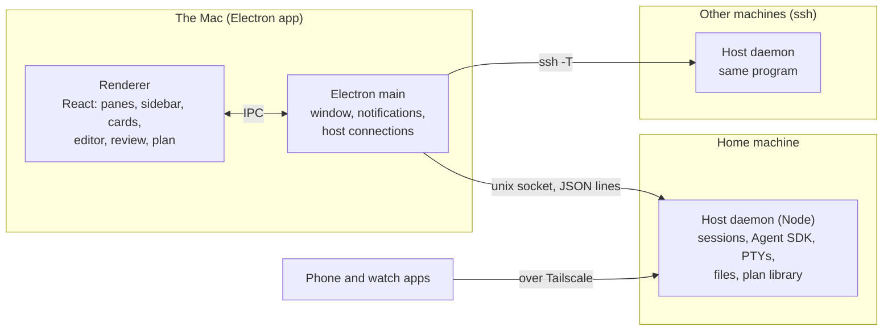

# Agent Deck

A macOS workbench for running many Claude Code agents at once: one person, dozens of agents, across
projects and machines. Built and used daily by one developer (iren). The code is private; this
repository holds the film and a description of how it works.

https://github.com/user-attachments/assets/86dfc90e-2e9e-4108-8a66-69ad53bbfb53

*Every screen in the film is Agent Deck itself, recorded with test data (fake agents, a local web
page, made-up machines). Nothing in it is staged in an editor.*

## What it does

- **Every project has a main agent and its workers.** You tell the main agent what you want; it
  splits the work into plan items and starts workers, each on its own branch, on this Mac or on
  any machine reachable over ssh (GPU boxes included).
- **The agents come to you only for decisions.** A question, a permission or a design to review
  arrives as a card; you answer on the Mac, the phone or the watch.
- **They use the same tools you do**: a browser panel you can watch, computer use on your Mac with
  a screenshot of every step, design reviews you mark up by drawing on them.
- **The plan keeps itself.** Areas, features, items, versions and the user's decisions in their own
  words live in a plan library the agents read and update; a new session starts from its lane's
  hand-over instead of from scratch.

## Architecture

- The **host daemon** is a plain Node program with no Electron in it. It owns the sessions (one
  Agent SDK `query()` each), terminals, file watchers and everything persisted, so agents keep
  running when the app is closed. The same program runs on every machine; the app deploys and
  upgrades it over ssh.
- **One protocol**: requests, responses and events, one JSON object per line. Every request carries
  the machine it is for, so a pane does not care where its agent runs.
- **Three roles of agent**: a main agent per project (splits work, keeps the plan, asks the user),
  workers (one lane each), and an operations session that reviews, runs the full tests and merges.

## Three hard problems

### 1. Dozens of agents changing one repository without stepping on each other

Each lane has one fixed git worktree and a branch per version (`deck/<lane>-<version>`), so no two
agents edit the same checkout. A worker never merges itself: it asks the operations session for a
review, runs the full tests only after "ready to merge", and the operations session fast-forwards
`main` (and rebases itself when `main` moved on and the merge is clean). Files that many changes
touch are split by side (host and app logic vs. interface and styling) so two agents don't edit
them at once.

### 2. Testing an app whose main input is a language model

The SDK's real output is recorded per SDK version, and a fake agent replays it, so the unit, host
and end-to-end suites run without calling a model. Anything that reads a new field of that output
must find it in the recording first. Code that talks to the real SDK gets one paid real run before
it merges. End-to-end specs are cut into shards and run side by side on several Linux machines
(arm64 and x64), only the specs a change touches before a merge, every spec each night; a test
flaky three times in a week becomes a work item.

### 3. Letting one person only make the decisions

Agents don't ask in chat; they put a card: the question, the options with what each changes, and
their recommendation. Cards wait on the Mac, the phone and the watch. If the user is away for an
hour, an ordinary card is answered with the recommendation (and can be changed later); cards that
spend money, can't be undone or touch privacy always wait. Rules the user sets once ("technical
terms stay in English", "no metaphors in explanations") bind every session from then on.

## In numbers

Counted 2026-10-30 from the git history and the plan library.

| | |
|---|---|
| Days from first commit | 35 |
| Commits on `main` | 2,792 (busiest day: 256) |
| Releases | 93 |
| Plan items done | 1,727 |
| Decisions recorded in the user's words | 891 |
| Agent sessions started (since 2026-10-04) | 1,533 |
| Source | ~242k lines of TypeScript |
| Tests at the last full run | 1,410 unit · 571 host · 890 end-to-end |

## Built with

TypeScript, Electron, React, Node, the Claude Agent SDK, Monaco, xterm.js, Playwright; Swift for
the phone and watch apps. The film is made in Remotion from recordings of the app.

## Credits

Made by iren. Music: "Close Up" by Michael Ramir C. (Mixkit).
